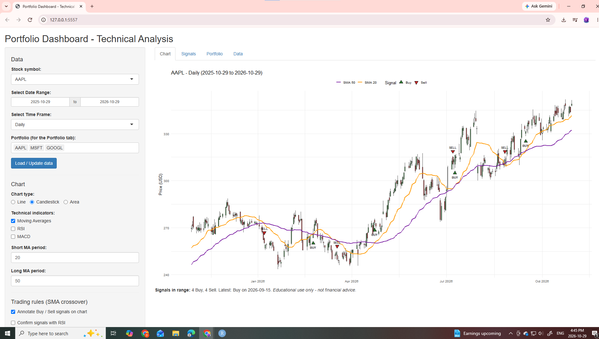
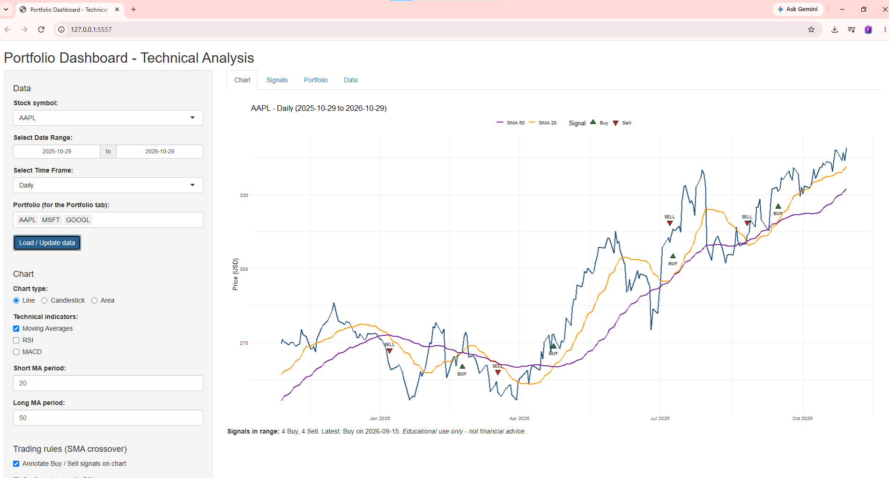
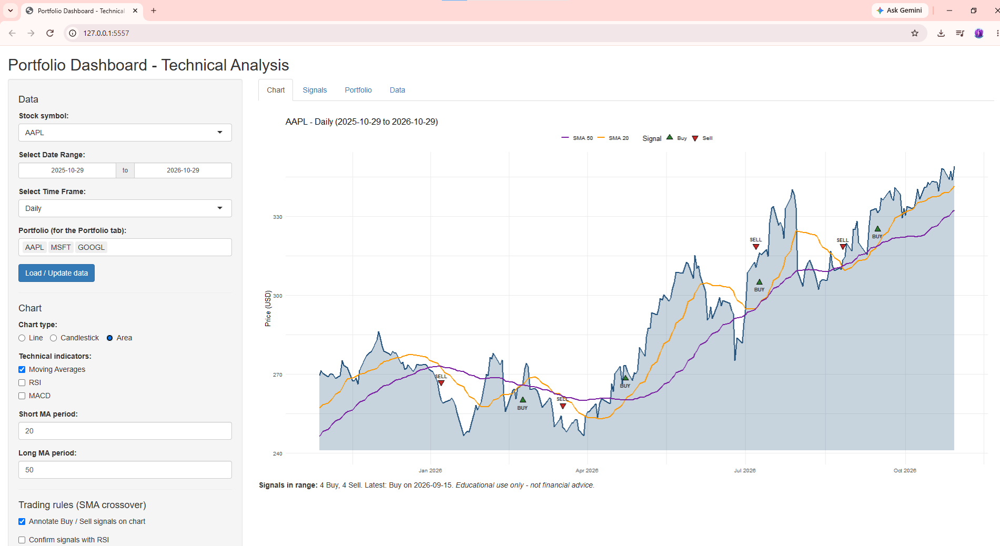
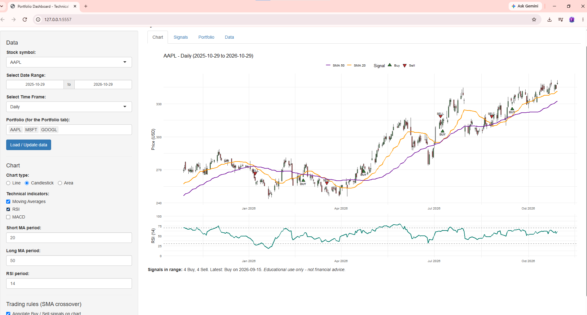
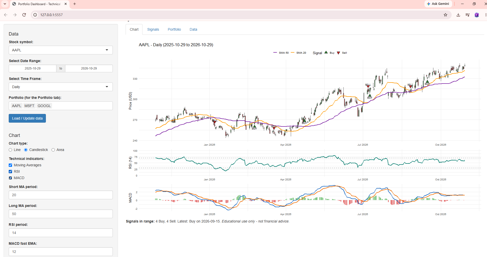
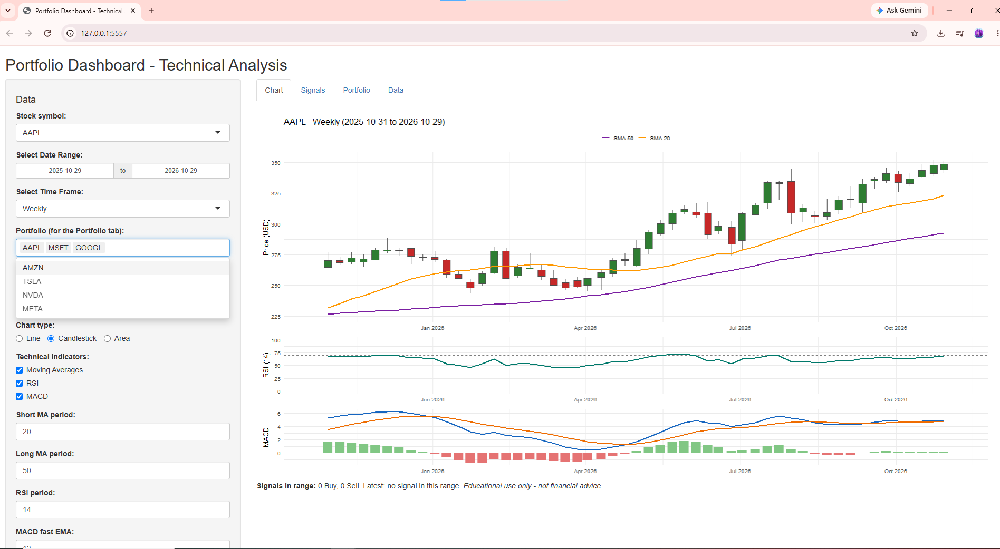

# Assignment 6 – Technical Analysis using R (Visualization Phase)

| | |
|---|---|
| **Student** | Alba Avila |
| **Course** | BDA400 – Data Science Tools and Techniques |
| **Assignment title** | Assignment 6: Technical Analysis using R, Visualization Phase |
| **Repository** | [https://github.com/ladajab1-ctrl/AlbaAvila_BDA400_A06](https://github.com/ladajab1-ctrl/AlbaAvila_BDA400_A06) |

## Project description

Interactive portfolio dashboard built with **R Shiny**. It downloads historical
stock data from **Yahoo Finance** (`quantmod`), visualizes it with **ggplot2**
(line, candlestick or area chart), overlays technical indicators (**Moving
Averages, RSI and MACD**) that can be switched on and off, and generates
**Buy / Sell / Hold** signals from a moving-average crossover rule, which are
annotated directly on the chart.

## How to run

Open `app.R` in RStudio and click **Run App**, or from the R console:

```r
shiny::runApp("app.R")
```

Missing packages (`shiny`, `ggplot2`, `quantmod`, `TTR`, `patchwork`) are
installed automatically the first time the script runs. An internet connection is required.

## Code organization (follows the assignment steps)

| Section in `app.R` | Assignment step |
|---|---|
| Step 1 – Data collection and setup | Data source, package installation/loading, `getSymbols()` wrapped with error handling |
| Step 2 – Visualizing stock data | Shiny skeleton, date range and time frame widgets, line / candlestick / area charts |
| Step 3 – Overlay technical indicators | SMA, RSI and MACD as layers/panels with check-box toggles |
| Step 4 – Trading rules and annotations | SMA crossover rule, optional RSI confirmation, Buy/Sell markers and labels |

## Features

- **Data:** Yahoo Finance via `quantmod`; any ticker can be typed in; errors (invalid symbol, no connection, missing data) are caught and reported in the app.
- **Widgets:** symbol, date range, time frame (Daily / Weekly / Monthly), chart type, indicator toggles, MA / RSI / MACD parameters.
- **Indicators:** SMA (short and long), RSI with 30/70 reference lines, MACD with signal line and histogram. Extra history is downloaded so indicators are fully drawn from the first visible bar.
- **Trading rules:** Buy when the short MA crosses above the long MA, Sell when it crosses below, Hold otherwise; customizable periods and optional RSI filter.
- **Annotations:** triangles and labels on the bars where a signal fires, plus a table of all signals.
- **Portfolio tab:** compares several tickers rebased to 100, with total return and annualized volatility.

## Screenshots (AAPL, SMA 20 / SMA 50)

**Candlestick chart with moving averages and Buy/Sell signals**



**Line chart** and **area chart**




**Indicator overlays switched on and off: RSI, then RSI + MACD**




**Weekly time frame with all indicators**



> Educational project – not financial advice.
